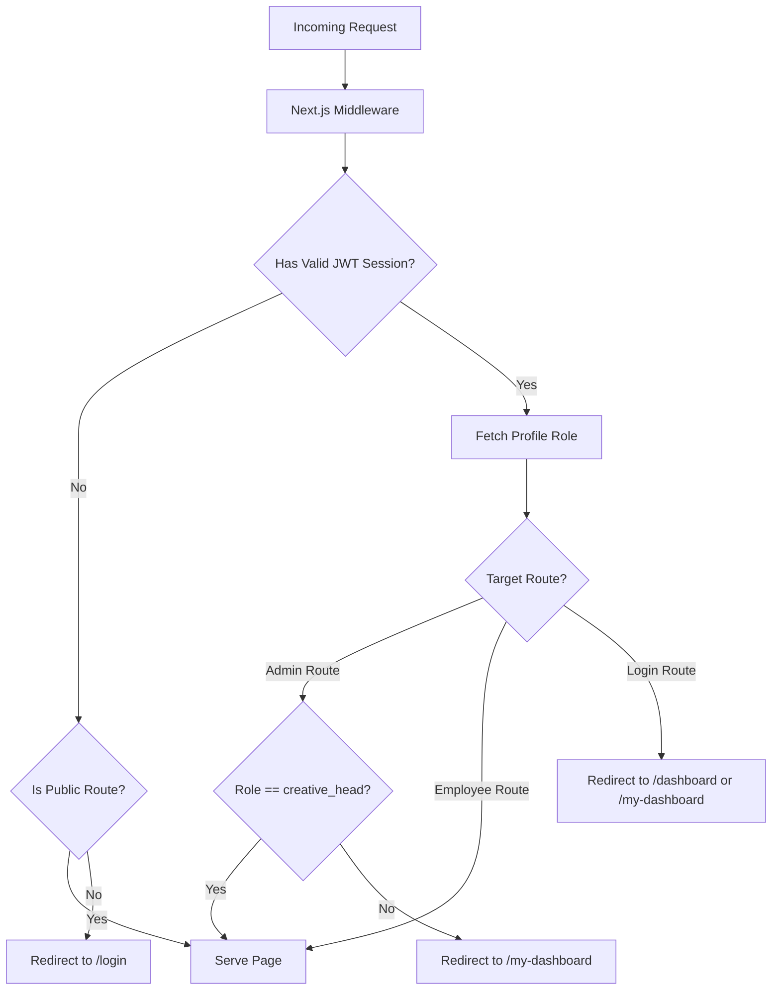
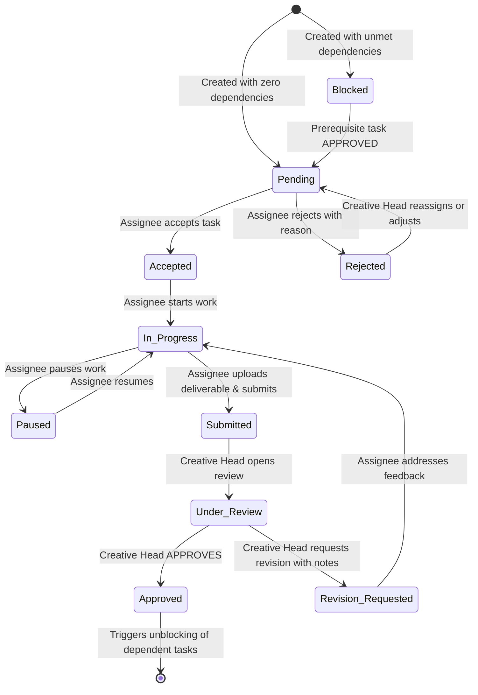

# CreativeFlow — Technical Architecture & System Design

## 1. High-Level System Architecture

CreativeFlow uses a modern, server-driven, enterprise-grade Jamstack architecture combining **Next.js App Router** with **Supabase managed cloud services** (Auth, Postgres, Storage, and Realtime).

```
+-----------------------------------------------------------------------------------------+
|                                    CLIENT BROWSERS                                      |
|            Desktop Chrome/Edge/Firefox/Safari      Mobile Responsive Web (iOS/Android)   |
+-----------------------------------------------------------------------------------------+
                                           │
                                    HTTPS / WSS
                                           ▼
+─────────────────────────────────────────────────────────────────────────────────────────+
|                                   VERCEL EDGE NETWORK                                   |
|   - DNS / SSL Termination / DDoS Mitigation                                             |
|   - Next.js Edge Middleware (Session Validation, Role Checking, Asia/Dhaka Routing)     |
+─────────────────────────────────────────────────────────────────────────────────────────+
                                           │
                         ┌─────────────────┴─────────────────┐
                         ▼                                   ▼
+─────────────────────────────────────────+ +─────────────────────────────────────────+
|          NEXT.JS SERVER RUNTIME         | |             STATIC ASSET CDN            |
|   - Server Components (RSC):            | |   - Compiled UI Bundles                 |
|     Secure DB queries, zero-bundle DB   | |   - Tailwind CSS Style Sheets           |
|     drivers, SSR initial paint          | |   - Brand Icons & Font Assets           |
|   - Server Actions & Route Handlers:    | +─────────────────────────────────────────+
|     Zod validation, business mutations  |
|   - Role Guard Wrappers                 |
+─────────────────────────────────────────+
                         │
        Supabase PostgreSQL Connection & REST / Storage
                         ▼
+─────────────────────────────────────────────────────────────────────────────────────────+
|                               SUPABASE MANAGED CLOUD                                    |
|  ┌─────────────────────┐  ┌─────────────────────┐  ┌──────────────────────────────────┐  |
|  |    Supabase Auth    |  | Supabase PostgreSQL |  |         Supabase Storage         |  |
|  |  - JWT / Sessions   |  |  - Row Level Sec.   |  |  - Project Buckets               |  |
|  |  - Role claims      |  |  - Automated Trigg. |  |  - Photography / Raw Footage     |  |
|  |  - Password resets  |  |  - Workflow State M.|  |  - Drafts / Revisions / Deliv.   |  |
|  └─────────────────────┘  └─────────────────────┘  └──────────────────────────────────┘  |
+─────────────────────────────────────────────────────────────────────────────────────────+
```

---

## 2. Directory & App Router Structure

The project will follow the modern Next.js App Router convention with modular organization:

```
CreativeFlow/
├── src/
│   ├── app/                                 # Next.js App Router
│   │   ├── (auth)/                          # Public Authentication Route Group
│   │   │   ├── login/
│   │   │   │   └── page.tsx
│   │   │   ├── forgot-password/
│   │   │   │   └── page.tsx
│   │   │   └── reset-password/
│   │   │       └── page.tsx
│   │   │
│   │   ├── (admin)/                         # Creative Head (Admin) Protected Route Group
│   │   │   ├── layout.tsx                   # Admin Shell (Navy Sidebar, Topbar, Alerts)
│   │   │   ├── dashboard/page.tsx           # Admin Master KPI Dashboard
│   │   │   ├── team/page.tsx                # Team Members, Workload, Performance
│   │   │   ├── projects/
│   │   │   │   ├── page.tsx                 # Projects List / Filter / New Modal
│   │   │   │   └── [id]/page.tsx            # Project Details, Timeline, Linked Tasks
│   │   │   ├── tasks/
│   │   │   │   ├── page.tsx                 # Master Tasks Kanban & Grid
│   │   │   │   └── create/page.tsx          # Comprehensive Task & Dependency Builder
│   │   │   ├── calendar/page.tsx            # Master Calendar & Drag-and-Drop Scheduler
│   │   │   ├── photography/page.tsx         # Shoot Schedules, Equipment & Shot Lists
│   │   │   ├── video-editing/page.tsx       # Aspect Ratios, Formats & Editing Queue
│   │   │   ├── approvals/page.tsx           # Review Queue & Revision Gatekeeper
│   │   │   ├── reports/page.tsx             # Analytics, Velocity Charts & CSV Export
│   │   │   ├── checkins/page.tsx            # Team Daily Attendance & EOD Feed
│   │   │   ├── notifications/page.tsx       # System Alerts & Log History
│   │   │   └── settings/page.tsx            # Workspace Settings & Integrations
│   │   │
│   │   ├── (employee)/                      # Contributor Protected Route Group (Editor & Photo)
│   │   │   ├── layout.tsx                   # Contributor Shell (Tailored for Individual Focus)
│   │   │   ├── my-dashboard/page.tsx        # Personal Daily Agenda & Urgent Tasks
│   │   │   ├── my-tasks/
│   │   │   │   ├── page.tsx                 # Assigned Tasks (Accept/Reject, Start, Pause)
│   │   │   │   └── [id]/page.tsx            # Task Workspace, Deliverable Submit Modal
│   │   │   ├── today/page.tsx               # Today's Work Queue
│   │   │   ├── upcoming/page.tsx            # Unblocked Future Work Pipeline
│   │   │   ├── my-calendar/page.tsx         # Personal Schedule & Shoot Calendar
│   │   │   ├── revisions/page.tsx           # Actionable Revision Requests
│   │   │   ├── history/page.tsx             # Completed Work Portfolio
│   │   │   ├── checkin/page.tsx             # Morning Attendance & EOD Report Form
│   │   │   └── profile/page.tsx             # Personal Profile & Availability Toggle
│   │   │
│   │   ├── api/                             # Internal Server Route Handlers
│   │   │   ├── auth/callback/route.ts       # Supabase OAuth/Auth Session Exchange
│   │   │   ├── export/csv/route.ts          # Sanitized CSV Generation
│   │   │   └── webhooks/route.ts            # Optional Google Calendar Webhook
│   │   ├── layout.tsx                       # Root Layout (Theme, Toast, Font, Meta)
│   │   └── page.tsx                         # Landing Redirect (Routes to login or dashboard)
│   │
│   ├── components/                          # Reusable UI Components
│   │   ├── ui/                              # shadcn/ui Base Primitives (Button, Dialog, etc.)
│   │   ├── layout/                          # App Shell (Sidebar, MobileNav, Topbar, UserMenu)
│   │   ├── dashboard/                       # KPI Cards, Velocity Graphs, Member Workload
│   │   ├── projects/                        # Project Cards, Project Form, Milestone Tracker
│   │   ├── tasks/                           # Kanban Columns, Task Card, Dependency Picker
│   │   ├── calendar/                        # MonthGrid, WeekTimeline, ConflictAlert
│   │   ├── checkin/                         # MorningModal, EODForm, TeamCheckinTable
│   │   ├── photography/                     # ShootPlanner, ShotListEditor, GearChecklist
│   │   ├── video/                           # AspectRatioBadge, VideoSpecsModal, ReviewPlayer
│   │   ├── approvals/                       # RevisionModal, ApprovalHistoryTimeline
│   │   └── shared/                          # EmptyState, ErrorBoundary, ConfirmDialog, LoadingSpinner
│   │
│   ├── lib/                                 # Shared Infrastructure
│   │   ├── supabase/
│   │   │   ├── client.ts                    # Client-side Supabase Browser Client
│   │   │   ├── server.ts                    # Server Component & Server Action Client
│   │   │   ├── middleware.ts                # Edge Cookie Session Token Refresher
│   │   │   └── types.ts                     # Auto-generated TypeScript DB Types
│   │   ├── validations/                     # Zod Schemas (Auth, Project, Task, Checkin, Shoot)
│   │   ├── workflow/                        # DAG Dependency Engine & Cycle Detection
│   │   ├── timezone/                        # Asia/Dhaka Formatting Helpers
│   │   └── utils.ts                         # Tailwind CSS `cn()` and Formatting Utilities
│   │
│   ├── actions/                             # Next.js Server Actions (Mutations)
│   │   ├── auth.actions.ts                  # Login, Logout, Password Reset
│   │   ├── project.actions.ts               # Create, Update, Delete Projects
│   │   ├── task.actions.ts                  # Create, Accept, Reject, Submit Tasks
│   │   ├── workflow.actions.ts              # Approve, Request Revision, Trigger Next
│   │   ├── checkin.actions.ts               # Submit Morning/EOD Check-in
│   │   ├── shoot.actions.ts                 # Update Shoot Plan & Checklists
│   │   └── storage.actions.ts               # Upload & Signed URL Generator
│   │
│   ├── types/                               # TypeScript Definitions
│   │   ├── database.ts                      # Supabase Generated Definitions
│   │   ├── navigation.ts                    # Sidebar Nav Item Definitions
│   │   └── models.ts                        # Domain View Models
│   └── middleware.ts                        # Next.js Edge Middleware
├── supabase/
│   ├── migrations/
│   │   └── 20261121000000_initial_schema.sql # Complete 13-table DDL & RLS
│   └── seed.sql                             # Seed Data (4 initial users, sample project)
├── PROJECT_PLAN.md
├── DATABASE_SCHEMA.md
├── ARCHITECTURE.md
├── IMPLEMENTATION_STATUS.md
└── README.md
```

---

## 3. Authentication & Role-Based Middleware

### 3.1 Authentication Flow & Session Management
1. User enters email and password at `/login`.
2. Supabase Auth validates credentials, sets secure HTTP-only cookies storing access token and refresh token.
3. `middleware.ts` runs on every request:
   - Validates JWT session with Supabase server client.
   - Extracts `role` from the authenticated user's `profiles` record.
   - Enforces routing rules:
     - Unauthenticated requests to `(admin)/*` or `(employee)/*` are redirected to `/login`.
     - Contributor roles (`video_editor`, `photographer`) attempting to access `(admin)/*` are blocked with an immediate redirect to `/my-dashboard`.
     - Creative Head accessing root is routed directly to `/dashboard`.



---

## 4. Automated Workflow Engine State Machine

The workflow engine enforces strict task progression. A child task cannot be started or submitted while its prerequisite is incomplete.



### Directed Acyclic Graph (DAG) Cycle Prevention
Before inserting any dependency record `(task_id, prerequisite_task_id)` into `task_dependencies`:
1. The system performs a Depth-First Search (DFS) / topological traversal.
2. If `prerequisite_task_id` already directly or transitively depends on `task_id`, the creation is rejected with an explicit validation error: *"Circular dependency detected: Task A cannot depend on Task B which already depends on Task A."*

---

## 5. Supabase Storage Organization & Access Security

### 5.1 Bucket Hierarchy
A single managed Supabase Storage bucket `creativeflow-assets` is organized with deterministic folder structures:

```
creativeflow-assets/
├── projects/
│   └── [project_id]/
│       ├── photography/             # Shot lists, references, raw exports
│       ├── raw-footage/             # Camera files, audio stems, interviews
│       ├── editing-projects/        # Premiere (.prproj), Final Cut, DaVinci project bundles
│       ├── drafts/                  # Versioned video drafts (v1, v2, v3)
│       ├── revisions/               # Review screencaps, marked up frames
│       └── final-delivery/          # Master exports (ProRes, H.264, 9:16 reels, 16:9 4K)
└── avatars/                         # User profile pictures
```

### 5.2 Storage Security Policies
- **Read**: Authenticated users can read assets belonging to projects they are members of.
- **Upload**: Assignees can upload to `drafts/`, `raw-footage/`, and `photography/` folders for their assigned tasks.
- **Final Delivery**: Restricted to Creative Head or tasks marked as `submitted` by assignees.
- **Direct Streaming / Signed URLs**: Heavy media assets utilize short-lived signed URLs (1 hour) for secure browser playback without public bucket exposure.
- **External Storage Integration**: For ultra-large video files (e.g. 50GB raw camera footage), users can register external Google Drive / Dropbox URLs with format validation.

---

## 6. Timezone Architecture (Asia/Dhaka UTC+6)

CreativeFlow operates strictly on Bangladesh Standard Time (BST, UTC+6):
1. **Database Layer**: All timestamps are stored as PostgreSQL `TIMESTAMPTZ` in UTC to ensure universal synchronization and daylight-drift immunity.
2. **Server Layer**: Dates are parsed and formatted using `date-fns-tz` with explicit timezone identifier `'Asia/Dhaka'`.
3. **Daily Check-in Windows**:
   - Morning Check-in is considered "On Time" if completed between 09:00 AM and 10:30 AM Asia/Dhaka.
   - End-of-Day report is prompted between 05:30 PM and 08:00 PM Asia/Dhaka.
4. **Calendar Display**: The calendar grid explicitly maps days from 00:00 to 23:59 Asia/Dhaka, preventing timezone-offset shifting across the midnight boundary.

---

## 7. Performance & Scalability Strategy

1. **Server-Side Rendering (SSR) & Streaming**:
   - Dashboards load data directly on the server via Supabase client, avoiding client-side waterfall requests.
   - Suspense boundaries are used for heavy UI sections (e.g., project progress charts and activity feeds) to guarantee instant first contentful paint.
2. **Granular Database Indexing**:
   - B-Tree indexes on `tasks(project_id)`, `tasks(assigned_to)`, `tasks(status)`, `tasks(due_date)`, and `task_dependencies(task_id, prerequisite_task_id)` guarantee sub-10ms query execution even with tens of thousands of tasks.
3. **Optimistic UI Updates**:
   - Kanban drag-and-drop status changes and task check-offs update the UI optimistically, reverting automatically if the server action rejects.
4. **Defensive Input Validation**:
   - All server actions strictly validate payloads with Zod schemas before touching the database.
