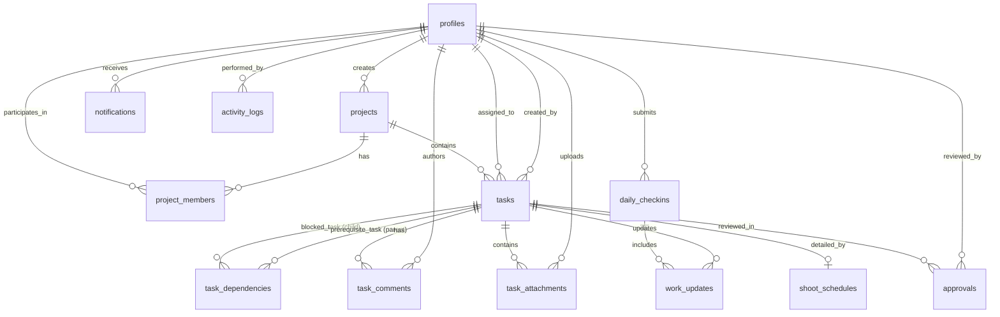

# CreativeFlow — Complete Database Schema & Security Architecture

This document defines the complete, production-ready PostgreSQL relational database schema for **CreativeFlow**, designed for deployment on Supabase PostgreSQL.

---

## 1. Entity-Relationship Overview



---

## 2. Enumerated Types (Enums)

| Enum Name | Values | Purpose |
| :--- | :--- | :--- |
| `user_role` | `'creative_head'`, `'video_editor'`, `'photographer'` | Strict system roles determining RLS access rights. |
| `project_priority` | `'low'`, `'medium'`, `'high'`, `'urgent'` | Project-level urgency classification. |
| `project_status` | `'planning'`, `'active'`, `'on_hold'`, `'completed'`, `'cancelled'` | High-level project lifecycle tracking. |
| `task_department` | `'photography'`, `'video_editing'`, `'creative_review'`, `'general'` | Department routing and filter categorization. |
| `task_priority` | `'low'`, `'medium'`, `'high'`, `'urgent'` | Task urgency rank. |
| `task_status` | `'pending'`, `'accepted'`, `'in_progress'`, `'submitted'`, `'revision_requested'`, `'approved'`, `'completed'`, `'cancelled'`, `'blocked'` | Workflow engine state lifecycle. |
| `dependency_type` | `'finish_to_start'`, `'start_to_start'` | Dependency logic (child task requires parent to be approved). |
| `approval_status` | `'pending'`, `'approved'`, `'revision_requested'`, `'rejected'` | Formal review outcome. |
| `notification_type` | `'task_assigned'`, `'task_accepted'`, `'task_started'`, `'task_submitted'`, `'task_approved'`, `'revision_requested'`, `'deadline_approaching'`, `'task_overdue'`, `'dependency_unblocked'`, `'schedule_changed'` | System event categorization. |
| `video_aspect_ratio`| `'9:16'`, `'16:9'`, `'1:1'` | Specific video format requirement. |

---

## 3. Comprehensive Table Specifications

### 3.1 `profiles`
Extends `auth.users` with user metadata, system roles, and contact details.
- `id` (UUID, PK, References `auth.users.id` ON DELETE CASCADE)
- `email` (TEXT, NOT NULL, UNIQUE)
- `full_name` (TEXT, NOT NULL)
- `role` (`user_role`, NOT NULL, DEFAULT `'video_editor'`)
- `phone` (TEXT)
- `avatar_url` (TEXT)
- `timezone` (TEXT, NOT NULL, DEFAULT `'Asia/Dhaka'`)
- `is_active` (BOOLEAN, NOT NULL, DEFAULT TRUE)
- `created_at` (TIMESTAMPTZ, NOT NULL, DEFAULT NOW())
- `updated_at` (TIMESTAMPTZ, NOT NULL, DEFAULT NOW())

### 3.2 `projects`
Stores high-level campaigns and client deliverables.
- `id` (UUID, PK, DEFAULT `gen_random_uuid()`)
- `name` (TEXT, NOT NULL)
- `description` (TEXT)
- `client_name` (TEXT, NOT NULL)
- `start_date` (DATE, NOT NULL)
- `deadline` (DATE, NOT NULL)
- `priority` (`project_priority`, NOT NULL, DEFAULT `'medium'`)
- `status` (`project_status`, NOT NULL, DEFAULT `'planning'`)
- `folder_url` (TEXT) — External reference (e.g. Google Drive master folder)
- `created_by` (UUID, NOT NULL, References `profiles.id`)
- `created_at` (TIMESTAMPTZ, NOT NULL, DEFAULT NOW())
- `updated_at` (TIMESTAMPTZ, NOT NULL, DEFAULT NOW())

### 3.3 `project_members`
Association table mapping team members to projects with explicit role designations.
- `id` (UUID, PK, DEFAULT `gen_random_uuid()`)
- `project_id` (UUID, NOT NULL, References `projects.id` ON DELETE CASCADE)
- `user_id` (UUID, NOT NULL, References `profiles.id` ON DELETE CASCADE)
- `assigned_role` (TEXT, NOT NULL)
- `assigned_at` (TIMESTAMPTZ, NOT NULL, DEFAULT NOW())
- **Constraint**: `UNIQUE(project_id, user_id)`

### 3.4 `tasks`
Central operational entity for all creative activities.
- `id` (UUID, PK, DEFAULT `gen_random_uuid()`)
- `project_id` (UUID, NOT NULL, References `projects.id` ON DELETE CASCADE)
- `title` (TEXT, NOT NULL)
- `description` (TEXT)
- `department` (`task_department`, NOT NULL)
- `assigned_to` (UUID, References `profiles.id` ON DELETE SET NULL)
- `created_by` (UUID, NOT NULL, References `profiles.id`)
- `start_date` (DATE)
- `start_time` (TIME)
- `due_date` (DATE, NOT NULL)
- `due_time` (TIME, NOT NULL, DEFAULT `'18:00:00'`)
- `estimated_hours` (NUMERIC(5,2), DEFAULT 0.0)
- `actual_hours` (NUMERIC(5,2), DEFAULT 0.0)
- `priority` (`task_priority`, NOT NULL, DEFAULT `'medium'`)
- `status` (`task_status`, NOT NULL, DEFAULT `'pending'`)
- `deliverable_url` (TEXT) — Supabase Storage URL or external video/photo review URL
- `rejection_reason` (TEXT) — Populated when editor/photographer rejects assignment
- `video_specs` (JSONB) — Video-specific metadata: `{ "aspect_ratio": "9:16", "duration_seconds": 60, "format": "mp4", "has_subtitles": true, "audio_tracks": ["voiceover.mp3", "bgm.mp3"] }`
- `created_at` (TIMESTAMPTZ, NOT NULL, DEFAULT NOW())
- `updated_at` (TIMESTAMPTZ, NOT NULL, DEFAULT NOW())

### 3.5 `task_dependencies`
Enforces sequential workflow execution and unblocking logic.
- `id` (UUID, PK, DEFAULT `gen_random_uuid()`)
- `task_id` (UUID, NOT NULL, References `tasks.id` ON DELETE CASCADE) — *The blocked/child task*
- `prerequisite_task_id` (UUID, NOT NULL, References `tasks.id` ON DELETE CASCADE) — *The prerequisite/parent task*
- `dependency_type` (`dependency_type`, NOT NULL, DEFAULT `'finish_to_start'`)
- `created_at` (TIMESTAMPTZ, NOT NULL, DEFAULT NOW())
- **Constraints**:
  - `UNIQUE(task_id, prerequisite_task_id)`
  - `CHECK(task_id <> prerequisite_task_id)` (Self-dependency forbidden)

### 3.6 `task_comments`
Discussion feed for revisions, instructions, and queries.
- `id` (UUID, PK, DEFAULT `gen_random_uuid()`)
- `task_id` (UUID, NOT NULL, References `tasks.id` ON DELETE CASCADE)
- `user_id` (UUID, NOT NULL, References `profiles.id` ON DELETE CASCADE)
- `comment` (TEXT, NOT NULL)
- `is_revision_feedback` (BOOLEAN, NOT NULL, DEFAULT FALSE)
- `created_at` (TIMESTAMPTZ, NOT NULL, DEFAULT NOW())

### 3.7 `task_attachments`
File metadata referencing Supabase Storage and external media.
- `id` (UUID, PK, DEFAULT `gen_random_uuid()`)
- `task_id` (UUID, NOT NULL, References `tasks.id` ON DELETE CASCADE)
- `uploaded_by` (UUID, NOT NULL, References `profiles.id`)
- `file_name` (TEXT, NOT NULL)
- `file_path` (TEXT, NOT NULL) — Path within Supabase Storage bucket
- `file_size_bytes` (BIGINT, NOT NULL)
- `mime_type` (TEXT, NOT NULL)
- `category` (TEXT, NOT NULL) — `'photography'`, `'raw_footage'`, `'editing_project'`, `'draft'`, `'revision'`, `'final_delivery'`, `'reference'`
- `is_external` (BOOLEAN, NOT NULL, DEFAULT FALSE)
- `external_url` (TEXT)
- `created_at` (TIMESTAMPTZ, NOT NULL, DEFAULT NOW())

### 3.8 `daily_checkins`
Tracks morning availability and end-of-day wrap-up.
- `id` (UUID, PK, DEFAULT `gen_random_uuid()`)
- `user_id` (UUID, NOT NULL, References `profiles.id` ON DELETE CASCADE)
- `checkin_date` (DATE, NOT NULL)
- `morning_checkin_time` (TIMESTAMPTZ)
- `is_available` (BOOLEAN, NOT NULL, DEFAULT TRUE)
- `morning_notes` (TEXT)
- `eod_submission_time` (TIMESTAMPTZ)
- `eod_notes` (TEXT)
- `tomorrow_plan` (TEXT)
- `delays_reason` (TEXT)
- `status` (TEXT, NOT NULL, DEFAULT `'present'`) — `'present'`, `'absent'`, `'on_leave'`
- `created_at` (TIMESTAMPTZ, NOT NULL, DEFAULT NOW())
- `updated_at` (TIMESTAMPTZ, NOT NULL, DEFAULT NOW())
- **Constraint**: `UNIQUE(user_id, checkin_date)`

### 3.9 `work_updates`
Links specific tasks to daily check-in reports for granular productivity audit.
- `id` (UUID, PK, DEFAULT `gen_random_uuid()`)
- `daily_checkin_id` (UUID, NOT NULL, References `daily_checkins.id` ON DELETE CASCADE)
- `task_id` (UUID, NOT NULL, References `tasks.id` ON DELETE CASCADE)
- `hours_spent` (NUMERIC(4,2), NOT NULL, DEFAULT 0.0)
- `progress_percent` (INTEGER, NOT NULL, DEFAULT 0, CHECK (progress_percent BETWEEN 0 AND 100))
- `status_update` (`task_status`, NOT NULL)
- `notes` (TEXT)
- `created_at` (TIMESTAMPTZ, NOT NULL, DEFAULT NOW())

### 3.10 `shoot_schedules`
Dedicated photography session planning specs.
- `id` (UUID, PK, DEFAULT `gen_random_uuid()`)
- `task_id` (UUID, NOT NULL, UNIQUE, References `tasks.id` ON DELETE CASCADE)
- `product_name` (TEXT, NOT NULL)
- `product_sku` (TEXT)
- `shoot_date` (DATE, NOT NULL)
- `shoot_start_time` (TIME, NOT NULL)
- `shoot_end_time` (TIME, NOT NULL)
- `location_name` (TEXT, NOT NULL)
- `location_address` (TEXT)
- `model_requirements` (TEXT)
- `outfit_specs` (TEXT)
- `shot_list` (JSONB, NOT NULL, DEFAULT '[]'::jsonb) — `[{"id": 1, "description": "Hero product front 45 deg", "completed": false}]`
- `camera_equipment_checklist` (JSONB, NOT NULL, DEFAULT '[]'::jsonb) — `[{"item": "Sony A7 IV", "packed": true}]`
- `lighting_checklist` (JSONB, NOT NULL, DEFAULT '[]'::jsonb) — `[{"item": "Godox SL60W Key", "packed": true}]`
- `raw_images_folder_url` (TEXT)
- `created_at` (TIMESTAMPTZ, NOT NULL, DEFAULT NOW())
- `updated_at` (TIMESTAMPTZ, NOT NULL, DEFAULT NOW())

### 3.11 `approvals`
Structured review gate audits with revision tracking.
- `id` (UUID, PK, DEFAULT `gen_random_uuid()`)
- `task_id` (UUID, NOT NULL, References `tasks.id` ON DELETE CASCADE)
- `reviewer_id` (UUID, NOT NULL, References `profiles.id`)
- `status` (`approval_status`, NOT NULL, DEFAULT `'pending'`)
- `review_notes` (TEXT)
- `revision_number` (INTEGER, NOT NULL, DEFAULT 1)
- `deliverable_version_url` (TEXT)
- `reviewed_at` (TIMESTAMPTZ)
- `created_at` (TIMESTAMPTZ, NOT NULL, DEFAULT NOW())

### 3.12 `notifications`
In-app alerts and notifications queue.
- `id` (UUID, PK, DEFAULT `gen_random_uuid()`)
- `user_id` (UUID, NOT NULL, References `profiles.id` ON DELETE CASCADE)
- `type` (`notification_type`, NOT NULL)
- `title` (TEXT, NOT NULL)
- `message` (TEXT, NOT NULL)
- `task_id` (UUID, References `tasks.id` ON DELETE CASCADE)
- `project_id` (UUID, References `projects.id` ON DELETE CASCADE)
- `is_read` (BOOLEAN, NOT NULL, DEFAULT FALSE)
- `created_at` (TIMESTAMPTZ, NOT NULL, DEFAULT NOW())

### 3.13 `activity_logs`
Immutable audit log tracking all operational events across the workspace.
- `id` (UUID, PK, DEFAULT `gen_random_uuid()`)
- `user_id` (UUID, References `profiles.id` ON DELETE SET NULL)
- `entity_type` (TEXT, NOT NULL) — `'project'`, `'task'`, `'shoot_schedule'`, `'approval'`, `'daily_checkin'`
- `entity_id` (UUID, NOT NULL)
- `action` (TEXT, NOT NULL) — `'created'`, `'updated'`, `'accepted'`, `'started'`, `'submitted'`, `'approved'`, `'revision_requested'`, `'deleted'`
- `metadata` (JSONB, DEFAULT '{}'::jsonb)
- `ip_address` (TEXT)
- `created_at` (TIMESTAMPTZ, NOT NULL, DEFAULT NOW())

---

## 4. Complete SQL Migration Script (DDL)

```sql
-- ====================================================================
-- CREATIVEFLOW PRODUCTION DATABASE SCHEMA MIGRATION
-- Timezone: Asia/Dhaka (UTC+6)
-- Target: Supabase Managed PostgreSQL
-- ====================================================================

-- 1. EXTENSIONS
CREATE EXTENSION IF NOT EXISTS "uuid-ossp";
CREATE EXTENSION IF NOT EXISTS "pgcrypto";

-- 2. CUSTOM TYPES & ENUMS
CREATE TYPE user_role AS ENUM ('creative_head', 'video_editor', 'photographer');
CREATE TYPE project_priority AS ENUM ('low', 'medium', 'high', 'urgent');
CREATE TYPE project_status AS ENUM ('planning', 'active', 'on_hold', 'completed', 'cancelled');
CREATE TYPE task_department AS ENUM ('photography', 'video_editing', 'creative_review', 'general');
CREATE TYPE task_priority AS ENUM ('low', 'medium', 'high', 'urgent');
CREATE TYPE task_status AS ENUM (
    'pending', 
    'accepted', 
    'in_progress', 
    'submitted', 
    'revision_requested', 
    'approved', 
    'completed', 
    'cancelled', 
    'blocked'
);
CREATE TYPE dependency_type AS ENUM ('finish_to_start', 'start_to_start');
CREATE TYPE approval_status AS ENUM ('pending', 'approved', 'revision_requested', 'rejected');
CREATE TYPE notification_type AS ENUM (
    'task_assigned', 
    'task_accepted', 
    'task_started', 
    'task_submitted', 
    'task_approved', 
    'revision_requested', 
    'deadline_approaching', 
    'task_overdue', 
    'dependency_unblocked', 
    'schedule_changed'
);

-- 3. PROFILES TABLE (Extends auth.users)
CREATE TABLE profiles (
    id UUID PRIMARY KEY REFERENCES auth.users(id) ON DELETE CASCADE,
    email TEXT NOT NULL UNIQUE,
    full_name TEXT NOT NULL,
    role user_role NOT NULL DEFAULT 'video_editor',
    phone TEXT,
    avatar_url TEXT,
    timezone TEXT NOT NULL DEFAULT 'Asia/Dhaka',
    is_active BOOLEAN NOT NULL DEFAULT TRUE,
    created_at TIMESTAMPTZ NOT NULL DEFAULT NOW(),
    updated_at TIMESTAMPTZ NOT NULL DEFAULT NOW()
);

-- 4. PROJECTS TABLE
CREATE TABLE projects (
    id UUID PRIMARY KEY DEFAULT gen_random_uuid(),
    name TEXT NOT NULL,
    description TEXT,
    client_name TEXT NOT NULL,
    start_date DATE NOT NULL,
    deadline DATE NOT NULL,
    priority project_priority NOT NULL DEFAULT 'medium',
    status project_status NOT NULL DEFAULT 'planning',
    folder_url TEXT,
    created_by UUID NOT NULL REFERENCES profiles(id),
    created_at TIMESTAMPTZ NOT NULL DEFAULT NOW(),
    updated_at TIMESTAMPTZ NOT NULL DEFAULT NOW(),
    CONSTRAINT check_project_dates CHECK (deadline >= start_date)
);

-- 5. PROJECT_MEMBERS TABLE
CREATE TABLE project_members (
    id UUID PRIMARY KEY DEFAULT gen_random_uuid(),
    project_id UUID NOT NULL REFERENCES projects(id) ON DELETE CASCADE,
    user_id UUID NOT NULL REFERENCES profiles(id) ON DELETE CASCADE,
    assigned_role TEXT NOT NULL DEFAULT 'contributor',
    assigned_at TIMESTAMPTZ NOT NULL DEFAULT NOW(),
    CONSTRAINT unique_project_member UNIQUE (project_id, user_id)
);

-- 6. TASKS TABLE
CREATE TABLE tasks (
    id UUID PRIMARY KEY DEFAULT gen_random_uuid(),
    project_id UUID NOT NULL REFERENCES projects(id) ON DELETE CASCADE,
    title TEXT NOT NULL,
    description TEXT,
    department task_department NOT NULL,
    assigned_to UUID REFERENCES profiles(id) ON DELETE SET NULL,
    created_by UUID NOT NULL REFERENCES profiles(id),
    start_date DATE,
    start_time TIME,
    due_date DATE NOT NULL,
    due_time TIME NOT NULL DEFAULT '18:00:00',
    estimated_hours NUMERIC(5,2) DEFAULT 0.0 CHECK (estimated_hours >= 0),
    actual_hours NUMERIC(5,2) DEFAULT 0.0 CHECK (actual_hours >= 0),
    priority task_priority NOT NULL DEFAULT 'medium',
    status task_status NOT NULL DEFAULT 'pending',
    deliverable_url TEXT,
    rejection_reason TEXT,
    video_specs JSONB DEFAULT '{}'::jsonb,
    created_at TIMESTAMPTZ NOT NULL DEFAULT NOW(),
    updated_at TIMESTAMPTZ NOT NULL DEFAULT NOW(),
    CONSTRAINT check_task_dates CHECK (due_date >= COALESCE(start_date, due_date))
);

-- 7. TASK_DEPENDENCIES TABLE
CREATE TABLE task_dependencies (
    id UUID PRIMARY KEY DEFAULT gen_random_uuid(),
    task_id UUID NOT NULL REFERENCES tasks(id) ON DELETE CASCADE,
    prerequisite_task_id UUID NOT NULL REFERENCES tasks(id) ON DELETE CASCADE,
    dependency_type dependency_type NOT NULL DEFAULT 'finish_to_start',
    created_at TIMESTAMPTZ NOT NULL DEFAULT NOW(),
    CONSTRAINT unique_dependency UNIQUE (task_id, prerequisite_task_id),
    CONSTRAINT prevent_self_dependency CHECK (task_id <> prerequisite_task_id)
);

-- 8. TASK_COMMENTS TABLE
CREATE TABLE task_comments (
    id UUID PRIMARY KEY DEFAULT gen_random_uuid(),
    task_id UUID NOT NULL REFERENCES tasks(id) ON DELETE CASCADE,
    user_id UUID NOT NULL REFERENCES profiles(id) ON DELETE CASCADE,
    comment TEXT NOT NULL,
    is_revision_feedback BOOLEAN NOT NULL DEFAULT FALSE,
    created_at TIMESTAMPTZ NOT NULL DEFAULT NOW()
);

-- 9. TASK_ATTACHMENTS TABLE
CREATE TABLE task_attachments (
    id UUID PRIMARY KEY DEFAULT gen_random_uuid(),
    task_id UUID NOT NULL REFERENCES tasks(id) ON DELETE CASCADE,
    uploaded_by UUID NOT NULL REFERENCES profiles(id),
    file_name TEXT NOT NULL,
    file_path TEXT NOT NULL,
    file_size_bytes BIGINT NOT NULL,
    mime_type TEXT NOT NULL,
    category TEXT NOT NULL CHECK (
        category IN ('photography', 'raw_footage', 'editing_project', 'draft', 'revision', 'final_delivery', 'reference')
    ),
    is_external BOOLEAN NOT NULL DEFAULT FALSE,
    external_url TEXT,
    created_at TIMESTAMPTZ NOT NULL DEFAULT NOW()
);

-- 10. DAILY_CHECKINS TABLE
CREATE TABLE daily_checkins (
    id UUID PRIMARY KEY DEFAULT gen_random_uuid(),
    user_id UUID NOT NULL REFERENCES profiles(id) ON DELETE CASCADE,
    checkin_date DATE NOT NULL,
    morning_checkin_time TIMESTAMPTZ,
    is_available BOOLEAN NOT NULL DEFAULT TRUE,
    morning_notes TEXT,
    eod_submission_time TIMESTAMPTZ,
    eod_notes TEXT,
    tomorrow_plan TEXT,
    delays_reason TEXT,
    status TEXT NOT NULL DEFAULT 'present' CHECK (status IN ('present', 'absent', 'on_leave')),
    created_at TIMESTAMPTZ NOT NULL DEFAULT NOW(),
    updated_at TIMESTAMPTZ NOT NULL DEFAULT NOW(),
    CONSTRAINT unique_user_daily_checkin UNIQUE (user_id, checkin_date)
);

-- 11. WORK_UPDATES TABLE
CREATE TABLE work_updates (
    id UUID PRIMARY KEY DEFAULT gen_random_uuid(),
    daily_checkin_id UUID NOT NULL REFERENCES daily_checkins(id) ON DELETE CASCADE,
    task_id UUID NOT NULL REFERENCES tasks(id) ON DELETE CASCADE,
    hours_spent NUMERIC(4,2) NOT NULL DEFAULT 0.0 CHECK (hours_spent >= 0),
    progress_percent INTEGER NOT NULL DEFAULT 0 CHECK (progress_percent BETWEEN 0 AND 100),
    status_update task_status NOT NULL,
    notes TEXT,
    created_at TIMESTAMPTZ NOT NULL DEFAULT NOW()
);

-- 12. SHOOT_SCHEDULES TABLE
CREATE TABLE shoot_schedules (
    id UUID PRIMARY KEY DEFAULT gen_random_uuid(),
    task_id UUID NOT NULL UNIQUE REFERENCES tasks(id) ON DELETE CASCADE,
    product_name TEXT NOT NULL,
    product_sku TEXT,
    shoot_date DATE NOT NULL,
    shoot_start_time TIME NOT NULL,
    shoot_end_time TIME NOT NULL,
    location_name TEXT NOT NULL,
    location_address TEXT,
    model_requirements TEXT,
    outfit_specs TEXT,
    shot_list JSONB NOT NULL DEFAULT '[]'::jsonb,
    camera_equipment_checklist JSONB NOT NULL DEFAULT '[]'::jsonb,
    lighting_checklist JSONB NOT NULL DEFAULT '[]'::jsonb,
    raw_images_folder_url TEXT,
    created_at TIMESTAMPTZ NOT NULL DEFAULT NOW(),
    updated_at TIMESTAMPTZ NOT NULL DEFAULT NOW(),
    CONSTRAINT check_shoot_time CHECK (shoot_end_time > shoot_start_time)
);

-- 13. APPROVALS TABLE
CREATE TABLE approvals (
    id UUID PRIMARY KEY DEFAULT gen_random_uuid(),
    task_id UUID NOT NULL REFERENCES tasks(id) ON DELETE CASCADE,
    reviewer_id UUID NOT NULL REFERENCES profiles(id),
    status approval_status NOT NULL DEFAULT 'pending',
    review_notes TEXT,
    revision_number INTEGER NOT NULL DEFAULT 1 CHECK (revision_number >= 1),
    deliverable_version_url TEXT,
    reviewed_at TIMESTAMPTZ,
    created_at TIMESTAMPTZ NOT NULL DEFAULT NOW()
);

-- 14. NOTIFICATIONS TABLE
CREATE TABLE notifications (
    id UUID PRIMARY KEY DEFAULT gen_random_uuid(),
    user_id UUID NOT NULL REFERENCES profiles(id) ON DELETE CASCADE,
    type notification_type NOT NULL,
    title TEXT NOT NULL,
    message TEXT NOT NULL,
    task_id UUID REFERENCES tasks(id) ON DELETE CASCADE,
    project_id UUID REFERENCES projects(id) ON DELETE CASCADE,
    is_read BOOLEAN NOT NULL DEFAULT FALSE,
    created_at TIMESTAMPTZ NOT NULL DEFAULT NOW()
);

-- 15. ACTIVITY_LOGS TABLE
CREATE TABLE activity_logs (
    id UUID PRIMARY KEY DEFAULT gen_random_uuid(),
    user_id UUID REFERENCES profiles(id) ON DELETE SET NULL,
    entity_type TEXT NOT NULL,
    entity_id UUID NOT NULL,
    action TEXT NOT NULL,
    metadata JSONB DEFAULT '{}'::jsonb,
    ip_address TEXT,
    created_at TIMESTAMPTZ NOT NULL DEFAULT NOW()
);

-- ====================================================================
-- PERFORMANCE INDEXES
-- ====================================================================
CREATE INDEX idx_tasks_project_id ON tasks(project_id);
CREATE INDEX idx_tasks_assigned_to ON tasks(assigned_to);
CREATE INDEX idx_tasks_status ON tasks(status);
CREATE INDEX idx_tasks_due_date ON tasks(due_date);
CREATE INDEX idx_tasks_department ON tasks(department);
CREATE INDEX idx_task_dependencies_child ON task_dependencies(task_id);
CREATE INDEX idx_task_dependencies_parent ON task_dependencies(prerequisite_task_id);
CREATE INDEX idx_shoot_schedules_date ON shoot_schedules(shoot_date);
CREATE INDEX idx_daily_checkins_user_date ON daily_checkins(user_id, checkin_date);
CREATE INDEX idx_notifications_user_unread ON notifications(user_id, is_read);
CREATE INDEX idx_activity_logs_entity ON activity_logs(entity_type, entity_id);

-- ====================================================================
-- TRIGGERS: AUTOMATIC updated_at REFRESH
-- ====================================================================
CREATE OR REPLACE FUNCTION update_timestamp_column()
RETURNS TRIGGER AS $$
BEGIN
    NEW.updated_at = NOW();
    RETURN NEW;
END;
$$ LANGUAGE plpgsql;

CREATE TRIGGER trg_profiles_updated_at BEFORE UPDATE ON profiles FOR EACH ROW EXECUTE FUNCTION update_timestamp_column();
CREATE TRIGGER trg_projects_updated_at BEFORE UPDATE ON projects FOR EACH ROW EXECUTE FUNCTION update_timestamp_column();
CREATE TRIGGER trg_tasks_updated_at BEFORE UPDATE ON tasks FOR EACH ROW EXECUTE FUNCTION update_timestamp_column();
CREATE TRIGGER trg_daily_checkins_updated_at BEFORE UPDATE ON daily_checkins FOR EACH ROW EXECUTE FUNCTION update_timestamp_column();
CREATE TRIGGER trg_shoot_schedules_updated_at BEFORE UPDATE ON shoot_schedules FOR EACH ROW EXECUTE FUNCTION update_timestamp_column();
```

---

## 5. Security & Row Level Security (RLS) Policies

### 5.1 Helper Functions for RLS

```sql
-- Fast cached lookup of user role in current transaction
CREATE OR REPLACE FUNCTION get_user_role()
RETURNS user_role AS $$
    SELECT role FROM profiles WHERE id = auth.uid();
$$ LANGUAGE sql STABLE SECURITY DEFINER;

-- Check if current user is Creative Head
CREATE OR REPLACE FUNCTION is_creative_head()
RETURNS BOOLEAN AS $$
    SELECT EXISTS (
        SELECT 1 FROM profiles 
        WHERE id = auth.uid() AND role = 'creative_head'
    );
$$ LANGUAGE sql STABLE SECURITY DEFINER;
```

### 5.2 RLS Policy Definitions

#### Table: `profiles`
- **Enable RLS**: `ALTER TABLE profiles ENABLE ROW LEVEL SECURITY;`
- **Select**: Anyone authenticated can read user names/avatars/roles for collaboration.
  ```sql
  CREATE POLICY "Profiles viewable by authenticated users"
  ON profiles FOR SELECT TO authenticated USING (true);
  ```
- **Update**: Creative Head can update any profile; employees can only update their own avatar/phone.
  ```sql
  CREATE POLICY "Profiles updatable by self or admin"
  ON profiles FOR UPDATE TO authenticated
  USING (id = auth.uid() OR is_creative_head())
  WITH CHECK (
      is_creative_head() OR (id = auth.uid() AND role = (SELECT role FROM profiles WHERE id = auth.uid()))
  );
  ```

#### Table: `projects`
- **Enable RLS**: `ALTER TABLE projects ENABLE ROW LEVEL SECURITY;`
- **Select**:
  - Creative Head: View all projects.
  - Video Editor / Photographer: View only projects they are members of, or projects containing tasks assigned to them.
  ```sql
  CREATE POLICY "Projects select policy"
  ON projects FOR SELECT TO authenticated
  USING (
      is_creative_head() OR
      EXISTS (SELECT 1 FROM project_members pm WHERE pm.project_id = projects.id AND pm.user_id = auth.uid()) OR
      EXISTS (SELECT 1 FROM tasks t WHERE t.project_id = projects.id AND t.assigned_to = auth.uid())
  );
  ```
- **Insert / Update / Delete**: Restricted to Creative Head only.
  ```sql
  CREATE POLICY "Projects admin write policy"
  ON projects FOR ALL TO authenticated
  USING (is_creative_head())
  WITH CHECK (is_creative_head());
  ```

#### Table: `tasks`
- **Enable RLS**: `ALTER TABLE tasks ENABLE ROW LEVEL SECURITY;`
- **Select**:
  - Creative Head: View all tasks across all projects.
  - Video Editor: View ONLY tasks assigned to them, or unassigned video_editing tasks awaiting assignment.
  - Photographer: View ONLY tasks assigned to them, or photography tasks in their assigned projects.
  ```sql
  CREATE POLICY "Tasks select policy"
  ON tasks FOR SELECT TO authenticated
  USING (
      is_creative_head() OR
      assigned_to = auth.uid()
  );
  ```
- **Insert / Delete**: Creative Head only.
  ```sql
  CREATE POLICY "Tasks insert/delete admin only"
  ON tasks FOR INSERT TO authenticated
  WITH CHECK (is_creative_head());

  CREATE POLICY "Tasks delete admin only"
  ON tasks FOR DELETE TO authenticated
  USING (is_creative_head());
  ```
- **Update**:
  - Creative Head: Full update access (reschedule, reassign, change status).
  - Assignee: Can update only operational fields: `status` (e.g. from 'pending' to 'accepted' or 'submitted'), `rejection_reason`, `actual_hours`, `deliverable_url`, and `video_specs`.
  ```sql
  CREATE POLICY "Tasks update policy"
  ON tasks FOR UPDATE TO authenticated
  USING (
      is_creative_head() OR assigned_to = auth.uid()
  )
  WITH CHECK (
      is_creative_head() OR assigned_to = auth.uid()
  );
  ```

#### Table: `shoot_schedules`
- **Enable RLS**: `ALTER TABLE shoot_schedules ENABLE ROW LEVEL SECURITY;`
- **Select**:
  - Creative Head: All shoot schedules.
  - Photographer: Only schedules where the underlying task is assigned to them.
  ```sql
  CREATE POLICY "Shoot schedules select"
  ON shoot_schedules FOR SELECT TO authenticated
  USING (
      is_creative_head() OR
      EXISTS (SELECT 1 FROM tasks t WHERE t.id = shoot_schedules.task_id AND t.assigned_to = auth.uid())
  );
  ```
- **Insert / Update**: Creative Head can plan; Photographer can check off shot lists and equipment checklists.
  ```sql
  CREATE POLICY "Shoot schedules update"
  ON shoot_schedules FOR UPDATE TO authenticated
  USING (
      is_creative_head() OR
      EXISTS (SELECT 1 FROM tasks t WHERE t.id = shoot_schedules.task_id AND t.assigned_to = auth.uid())
  );
  ```

#### Table: `daily_checkins` & `work_updates`
- **Enable RLS**: `ALTER TABLE daily_checkins ENABLE ROW LEVEL SECURITY;`
- **Select**:
  - Creative Head: View all team check-ins and EOD reports.
  - Employee: View only their own daily check-ins.
  ```sql
  CREATE POLICY "Daily checkins select"
  ON daily_checkins FOR SELECT TO authenticated
  USING (
      is_creative_head() OR user_id = auth.uid()
  );

  CREATE POLICY "Daily checkins insert/update self"
  ON daily_checkins FOR ALL TO authenticated
  USING (user_id = auth.uid() OR is_creative_head())
  WITH CHECK (user_id = auth.uid() OR is_creative_head());
  ```

#### Table: `approvals`
- **Enable RLS**: `ALTER TABLE approvals ENABLE ROW LEVEL SECURITY;`
- **Select**: Creative Head can see all; assignees can see approvals and revision feedback for their tasks.
  ```sql
  CREATE POLICY "Approvals select"
  ON approvals FOR SELECT TO authenticated
  USING (
      is_creative_head() OR
      EXISTS (SELECT 1 FROM tasks t WHERE t.id = approvals.task_id AND t.assigned_to = auth.uid())
  );

  CREATE POLICY "Approvals insert/update admin"
  ON approvals FOR ALL TO authenticated
  USING (is_creative_head())
  WITH CHECK (is_creative_head());
  ```

#### Table: `notifications`
- **Enable RLS**: `ALTER TABLE notifications ENABLE ROW LEVEL SECURITY;`
- Strictly isolated to the recipient: `user_id = auth.uid()`.
  ```sql
  CREATE POLICY "Notifications recipient only"
  ON notifications FOR ALL TO authenticated
  USING (user_id = auth.uid())
  WITH CHECK (user_id = auth.uid());
  ```

---

## 6. Workflow Engine Automated Triggers

```sql
-- Automatically unblock dependent child tasks when prerequisite is approved
CREATE OR REPLACE FUNCTION handle_task_approval_workflow()
RETURNS TRIGGER AS $$
DECLARE
    dep_record RECORD;
    all_prereqs_satisfied BOOLEAN;
BEGIN
    -- Only trigger when a task status transitions to 'approved' or 'completed'
    IF NEW.status IN ('approved', 'completed') AND (OLD.status NOT IN ('approved', 'completed')) THEN
        -- Find all dependent child tasks
        FOR dep_record IN 
            SELECT task_id FROM task_dependencies WHERE prerequisite_task_id = NEW.id
        LOOP
            -- Check if all prerequisites for this child task are now approved/completed
            SELECT NOT EXISTS (
                SELECT 1 
                FROM task_dependencies td
                JOIN tasks t ON t.id = td.prerequisite_task_id
                WHERE td.task_id = dep_record.task_id
                AND t.status NOT IN ('approved', 'completed')
            ) INTO all_prereqs_satisfied;

            IF all_prereqs_satisfied THEN
                -- Unblock child task: transition from 'blocked' to 'pending'
                UPDATE tasks 
                SET status = 'pending' 
                WHERE id = dep_record.task_id AND status = 'blocked';

                -- Create notification for child task assignee
                INSERT INTO notifications (user_id, type, title, message, task_id)
                SELECT 
                    assigned_to, 
                    'dependency_unblocked', 
                    'Prerequisite Task Completed', 
                    'Task is now ready to begin: ' || title, 
                    id
                FROM tasks 
                WHERE id = dep_record.task_id AND assigned_to IS NOT NULL;
            END IF;
        END LOOP;
    END IF;

    -- If revision is requested, reactivate task to 'revision_requested'
    IF NEW.status = 'revision_requested' AND OLD.status <> 'revision_requested' THEN
        INSERT INTO notifications (user_id, type, title, message, task_id)
        SELECT 
            assigned_to, 
            'revision_requested', 
            'Revision Requested', 
            'Creative Head requested revisions on: ' || title, 
            id
        FROM tasks 
        WHERE id = NEW.id AND assigned_to IS NOT NULL;
    END IF;

    RETURN NEW;
END;
$$ LANGUAGE plpgsql SECURITY DEFINER;

CREATE TRIGGER trg_task_approval_workflow
AFTER UPDATE OF status ON tasks
FOR EACH ROW
EXECUTE FUNCTION handle_task_approval_workflow();
```
