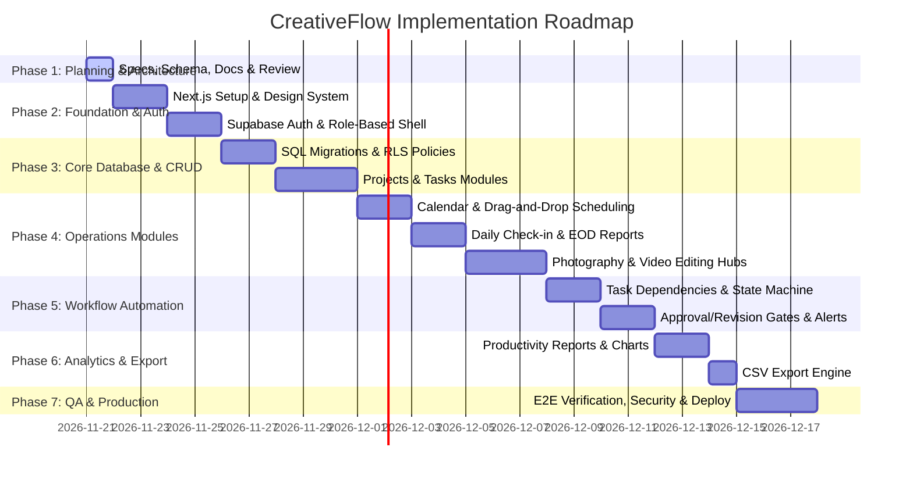

# CreativeFlow — Master Project Plan

## 1. Executive Summary & Vision

**CreativeFlow** is an enterprise-grade, role-based Creative Team Management & Workflow Automation Software-as-a-Service (SaaS) application designed specifically for digital media and creative agencies. 

Initially tailored for an agile high-output creative team of four in Bangladesh (Asia/Dhaka timezone, UTC+6):
- **1 Creative Head (Admin)**: Oversees creative direction, assigns projects and tasks, manages team capacity, conducts reviews, and handles approvals/revisions.
- **2 Video Editors (Role: Video Editor)**: Focus on motion graphics, reel editing, long-form YouTube editing, aspect-ratio formatting (9:16, 16:9, 1:1), and draft delivery.
- **1 Photographer (Role: Photographer)**: Manages shoot schedules, camera/lighting equipment checklists, location shoots, raw photo/footage deliveries, and shot lists.

The primary objective is to replace fragmented tools (WhatsApp groups, spreadsheets, unorganized Google Drive folders) with a deterministic, dependency-driven workflow engine where work transitions automatically across stages (Photography → Raw Ingestion → Editing → Review → Revisions → Final Export → Completion) without dropped tasks, unapproved deliveries, or double-booked schedules.

---

## 2. Core Stakeholders & Role Matrix

| Stakeholder Role | Initial Users | Primary Responsibilities | Access Level |
| :--- | :--- | :--- | :--- |
| **Creative Head (Admin)** | 1 User (`head@creativeflow.com`) | Full administrative control, project creation, task assignment, workflow configuration, approval/revision gatekeeping, team performance evaluation, daily check-in monitoring, system settings. | System Administrator (Full Read/Write across all tenants/projects/tasks) |
| **Video Editor** | 2 Users (`editor1@creativeflow.com`, `editor2@creativeflow.com`) | Task acceptance/rejection with reason, video drafting, duration/aspect-ratio adherence, draft delivery uploading, revision resolution, daily morning check-in & EOD reporting. | Scoped Contributor (Read/Write assigned tasks, view relevant project assets) |
| **Photographer** | 1 User (`photo@creativeflow.com`) | Shoot planning, equipment checklist verification, location shoots, product/model coordination, raw photo & footage uploading, shot list tracking, daily morning check-in & EOD reporting. | Scoped Contributor (Read/Write assigned photography tasks & shoots) |

---

## 3. Technology Stack & Architectural Decisions

### 3.1 Stack Breakdown
| Layer | Technology | Justification |
| :--- | :--- | :--- |
| **Frontend Framework** | **Next.js (App Router)** | Server Components for instant initial page loads and secure session verification; Client Components for rich interactive Kanban boards, calendars, and drag-and-drop file uploads. |
| **Language** | **TypeScript (Strict Mode)** | Full end-to-end type safety between Supabase Database types, API payloads, and UI component props. |
| **Styling & Design System** | **Tailwind CSS + shadcn/ui** | Rapid, accessible, unstyled Radix UI primitives combined with utility classes conforming to the Linear/ClickUp SaaS aesthetic. |
| **Icons** | **Lucide Icons** | Clean, consistent, lightweight SVG iconography. |
| **Authentication** | **Supabase Auth** | Secure email/password login, JWT management, secure session cookies via `@supabase/ssr`, role metadata enforcement. |
| **Database** | **Supabase Managed PostgreSQL** | Relational integrity, foreign key cascades, JSONB fields for shot lists and equipment checklists, custom SQL triggers. |
| **Authorization & Security** | **PostgreSQL Row Level Security (RLS)** | Kernel-level data isolation. Prevents malicious URL parameter tampering or API scraping. |
| **File Storage** | **Supabase Storage + S3-compatible Buckets** | Structured folders for Photography, Raw Footage, Edits, Drafts, Revisions, and Deliverables, with RLS storage policies. |
| **Timezone Management** | **date-fns & date-fns-tz** | Strict handling of Asia/Dhaka (UTC+6) for shoot schedules, deadlines, daily check-ins, and reminders. |
| **Validation** | **Zod** | Schema validation on both server actions/API routes and client forms. |
| **Deployment** | **Vercel** | Edge network deployment with zero server maintenance overhead. |

---

## 4. Work Breakdown Structure (Phases 1 through 7)



### Detailed Phase Specifications

#### **Phase 1: Architecture, Planning & Schema Design (CURRENT)**
- Workspace inspection and environment verification.
- Complete specification documentation (`PROJECT_PLAN.md`, `DATABASE_SCHEMA.md`, `ARCHITECTURE.md`, `IMPLEMENTATION_STATUS.md`, `README.md`).
- Formulation of relational schema across 13 core tables, indexes, triggers, and RLS policies.
- UI/UX wireframe planning and role routing diagrams.
- User review and formal sign-off.

#### **Phase 2: Project Initialization, Design System & Auth Shell**
- Initialize Next.js with App Router, TypeScript, Tailwind CSS, Lucide Icons, and shadcn/ui.
- Implement the design tokens: Dark Navy sidebar (`#0F172A`), light background (`#F8FAFC`), modern typography, accent colors (Blue `#3B82F6`, Purple `#8B5CF6`, Teal `#14B8A6`).
- Create global application layout with responsive navigation (desktop sidebar + mobile drawer).
- Integrate Supabase Auth via `@supabase/ssr` with server-side cookie sessions.
- Build Public Auth Pages: `/login`, `/forgot-password`, `/reset-password`.
- Build Auth Middleware enforcing route protection and role-based redirects.

#### **Phase 3: Database Migrations, RLS & Core Modules**
- Run complete PostgreSQL migration applying all 13 tables, foreign keys, check constraints, and custom indexes.
- Apply strict PostgreSQL RLS policies ensuring isolation between roles.
- Create Supabase Storage buckets (`creativeflow-assets`) with granular folder policies.
- Build **Projects Module**:
  - Creative Head: Create, edit, archive, filter, and view project timelines.
  - Project detail page: Metadata, attached team members, linked tasks, storage folder links.
- Build **Tasks Module**:
  - Filterable Kanban Board and Table view.
  - Task creation modal with dynamic department selection, assignment, priority, estimated hours, and deadline pickers.
  - Role-specific task actions (Video Editor / Photographer accept, reject with reason, start, pause, submit).

#### **Phase 4: Operations & Specialized Creative Modules**
- Build **Calendar & Scheduling Module**:
  - Day, Week, Month, Team, and Project views.
  - Conflict detection engine preventing team member double-booking.
  - Asia/Dhaka timezone synchronization.
- Build **Daily Check-in & EOD System**:
  - Morning Check-in: Prompt for availability, daily focus tasks, accept work queue.
  - End-of-Day Report: Completed tasks, delayed tasks with mandatory reason, progress notes, tomorrow's plan.
  - Creative Head real-time team check-in board.
- Build **Photography Management Module**:
  - Shoot planner: Product details, SKU, shoot location, model requirements, outfit specs.
  - Interactive checklists for camera equipment and lighting gear.
  - Shot list status tracking.
  - Raw image upload and final delivery link repository.
- Build **Video Editing Management Module**:
  - Aspect ratio switcher (9:16 Vertical Reel/TikTok, 16:9 Horizontal YouTube/Broadcast, 1:1 Square Feed).
  - Duration limits, raw footage ingest links, reference video URLs.
  - Asset attachment sections: Voiceover, Background Music, Subtitles (.srt/.vtt).
  - Draft submission with timestamped version notes.

#### **Phase 5: Workflow Automation, Approvals & Notifications**
- Build **Dependency Engine**:
  - Relational task dependency graph (`task_dependencies`).
  - Circular dependency prevention (DAG cycle validation).
  - Automatic status transition: When a parent task is approved, unblock dependent child tasks and notify assignees.
- Build **Approval & Revision Loop**:
  - Creative Head review workspace with preview links and deliverable inspect mode.
  - One-click Approve or Request Revision with mandatory structured feedback.
  - Automated task state reset on revision request (moves child task back to In Progress / Revision Required).
- Build **In-App Notification Hub**:
  - Real-time notification badge, popover, and dedicated notifications page.
  - Event triggers: Assignment, Acceptance, Submission, Approval, Revision, Overdue alert, Schedule shift.

#### **Phase 6: Analytics, Performance Reports & CSV Export**
- Build **Creative Head Performance Hub**:
  - Real-time KPI summary widgets (Active Projects, Overdue Tasks, Review Queue, Team Workload).
  - Interactive charts:
    - Weekly productivity curve.
    - Monthly task completion velocity.
    - Member-wise efficiency and turnaround time.
    - Project progress completion meters.
- Build **Export Engine**:
  - Filterable date ranges.
  - Export task logs, team timesheets, and project completion metrics to sanitized CSV.

#### **Phase 7: Comprehensive Testing, Hardening & Deployment**
- End-to-end user journey verification for all 3 roles (`creative_head`, `video_editor`, `photographer`).
- Security penetration test on RLS policies (attempt unauthorized updates, URL tampering, and cross-user data leaks).
- Mobile responsiveness audit on iOS Safari and Android Chrome breakpoints.
- Production environment configuration on Vercel and Supabase.
- Deliver final operations manual and credential handoff documentation.

---

## 5. UI/UX Wireframe & Design System Plan

### 5.1 Color Palette
- **Primary Brand / Dark Sidebar**: `#0F172A` (Slate 900) / `#1E293B` (Slate 800)
- **Primary Brand Accent**: `#3B82F6` (Electric Blue)
- **Creative Accent / Revisions**: `#8B5CF6` (Vibrant Purple)
- **Success / Approvals**: `#10B981` (Emerald Teal)
- **Warning / Review Required**: `#F59E0B` (Amber Gold)
- **Urgent / Blocked / Overdue**: `#EF4444` (Crimson Red)
- **Light Background**: `#F8FAFC` (Slate 50) / Cards: `#FFFFFF` (White) with border `#E2E8F0` (Slate 200)
- **Dark Mode Background**: `#090D16` (Deep Navy) / Cards: `#131B2E` with border `#1E293B`

### 5.2 Typography & Spacing
- **Font Family**: Inter, -apple-system, BlinkMacSystemFont, "Segoe UI", Roboto, sans-serif.
- **Scale**:
  - Page Titles: `text-2xl font-bold tracking-tight text-slate-900 dark:text-white`
  - Section Headers: `text-lg font-semibold text-slate-800 dark:text-slate-100`
  - Body Text: `text-sm font-normal text-slate-600 dark:text-slate-400`
  - Captions / Badges: `text-xs font-medium`
- **Component Geometry**: Rounded cards (`rounded-xl`), subtle modern shadow (`shadow-sm` hovering to `shadow-md`), crisp 1px borders (`border border-slate-200/80 dark:border-slate-800`).

### 5.3 Page Layout Blueprint

```
+---------------------------------------------------------------------------------------------------+
|  CreativeFlow Logo        [Search tasks, projects...]         [Asia/Dhaka 11:24 AM]  [(3)Bell] [User] |
+------------------+--------------------------------------------------------------------------------+
|  NAVIGATION      |  PAGE CONTENT AREA                                                             |
|                  |                                                                                |
|  [Dashboard]     |  +-------------+  +-------------+  +-------------+  +-------------+            |
|  [Projects]      |  | Active Proj |  | Tasks In-Prg|  | Needs Review|  | Overdue     |            |
|  [Tasks]         |  |     12      |  |     28      |  |      5      |  |      2      |            |
|  [Calendar]      |  +-------------+  +-------------+  +-------------+  +-------------+            |
|  [Check-in]      |                                                                                |
|  [Photography]   |  +-------------------------------------+  +----------------------------------+ |
|  [Video Editing] |  | WORKFLOW AUTOMATION PIPELINE        |  | TEAM WORKLOAD & DAILY ATTENDANCE | |
|  [Approvals]     |  | Photo -> Edit -> Review -> Delivery |  | - Video Editor 01 (Checked in)   | |
|  [Reports]       |  |                                     |  | - Video Editor 02 (Checked in)   | |
|  [Team]          |  | [Live Interactive Dependency Graph] |  | - Photographer (On Shoot)        | |
|  [Settings]      |  +-------------------------------------+  +----------------------------------+ |
|                  |                                                                                |
|  (User Profile)  |  +---------------------------------------------------------------------------+ |
|  Role: Admin     |  | ACTIVE TASKS & RECENT REVISION FEEDBACK                                   | |
|  [Logout]        |  +---------------------------------------------------------------------------+ |
+------------------+--------------------------------------------------------------------------------+
```

---

## 6. Risk Analysis & Mitigation Matrix

| Identified Risk | Severity | Impact | Concrete Mitigation Strategy |
| :--- | :--- | :--- | :--- |
| **RLS Policy Bypass / Data Leakage** | Critical | Contributor viewing client rate cards, unauthorized projects, or other members' private tasks. | Apply kernel-level PostgreSQL RLS on all 13 tables. Validate role inside `auth.jwt()` and custom security definer functions. Write automated RLS verification scripts. |
| **Circular Workflow Dependencies** | High | System deadlock where Task A waits for Task B which waits for Task A. | Implement Directed Acyclic Graph (DAG) cycle detection algorithms in both frontend modal creation and database triggers. |
| **Accidental Double-Booking** | Medium | Photographer scheduled for two simultaneous shoots or editor assigned 30 hours of urgent deliverables due on the same day. | Implement real-time schedule conflict validation in the calendar module that warns/blocks overlapping time windows for the same assignee. |
| **Timezone Inconsistencies** | Medium | Due dates shifting by 6 hours between local browser and server storage. | Standardize database timestamp fields to `TIMESTAMPTZ` (UTC storage) and enforce conversion to `Asia/Dhaka` on display and input components. |
| **Lost Video Deliverables / Incomplete Uploads** | High | Upload failures for large video renders or loss of external links. | Support both direct chunked upload via Supabase Storage and validated external links (Google Drive, Dropbox, Frame.io) with format and permission verification. |

---

## 7. Quality Assurance & Sign-off Criteria
Every phase of CreativeFlow will satisfy:
1. **Zero TypeScript Errors**: Strict compilation with `noImplicitAny: true`.
2. **Zero Build Warnings**: Clean `next build` artifact creation.
3. **Role Enforcement Verification**: Automated test verification confirming that a Video Editor or Photographer cannot mutate project settings or view unassigned restricted tasks.
4. **Mobile Usability**: Flawless navigation on mobile viewports (375px+).
5. **Dhaka Timezone Accuracy**: Morning check-ins and due date badges calculate correctly according to Bangladesh Standard Time.
